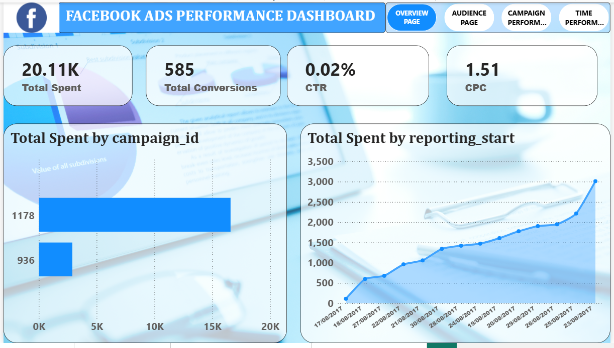

# Facebook Ads Performance Dashboard | Power BI

**Live Portfolio:** https://muhammad-ali-azam.github.io

### 📊 Overview
A complete 4-page dashboard to analyze Facebook Ads performance, spend, conversions, and ROI. This project helps in optimizing ad campaigns and audience targeting.

### 📑 4 Pages Included:
1.  **OVERVIEW PAGE** - Total Spent, Conversions, CTR, CPC (Screenshot Attached)
2.  **AUDIENCE PAGE** - Audience demographics & performance
3.  **CAMPAIGN PERFORMANCE PAGE** - Campaign-wise spend analysis
4.  **TIME PERFORMANCE PAGE** - Time-series performance trends

### 📁 Files in this Repository
- `2.png` - Overview Page Preview
- [📥 Download Complete 4-Page PBIX File (Google Drive)](https://drive.google.com/file/d/1Fn0CBHKMRHal8vUtcV_gv9GYQkovjCFj/view?usp=sharing)

> Note: PBIX file is hosted on Google Drive due to GitHub's 25MB file limit.

### 🛠️ Tools Used
- Power BI Desktop
- Data Modeling & DAX
- Time-Series Analysis

### 💡 Key Insights (From Overview Page)
- **20.11K** Total Spent | **585** Total Conversions
- **0.02%** CTR | **1.51** CPC
- Campaign ID 1178 has highest spend (4.87K)
- Daily Spend trend (Aug 10-15, 2017) analysis included

---
*Developed by Muhammad Ali Azam | Data Analyst from Multan | Power BI Developer*
